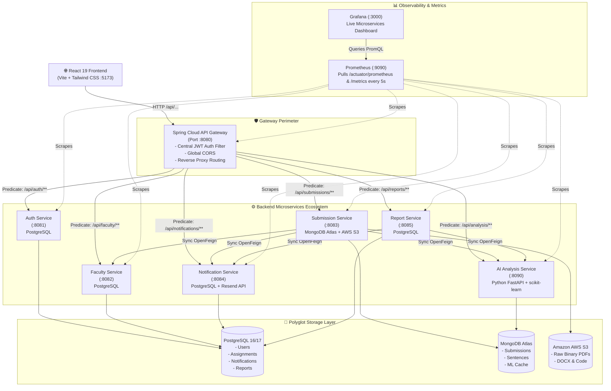
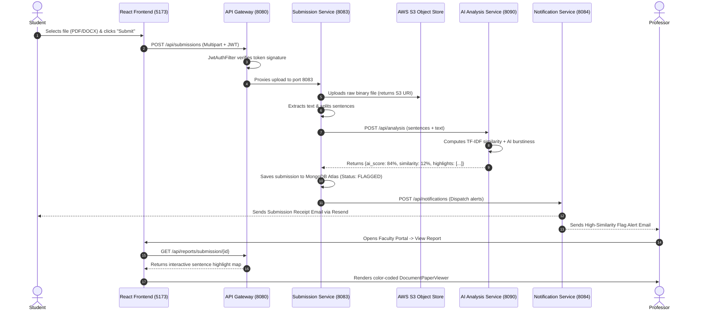

# 🛡️ IntegrityAI — Microservices-Based Academic Integrity & Plagiarism Platform

[](https://spring.io/projects/spring-boot)
[](https://spring.io/projects/spring-cloud)
[](https://fastapi.tiangolo.com/)
[](https://react.dev/)
[](https://www.docker.com/)
[](https://prometheus.io/)
[](https://grafana.com/)
[](https://www.postgresql.org/)
[](https://www.mongodb.com/)
[](https://aws.amazon.com/s3/)

---

## 📑 Table of Contents
1. [Problem Statement](#-problem-statement)
2. [Proposed Solution](#-proposed-solution)
3. [System Architecture & Topology](#-system-architecture--topology)
4. [Microservices Catalog & Port Allocation](#-microservices-catalog--port-allocation)
5. [Inter-Service Communication & Protocols](#-inter-service-communication--protocols)
6. [End-to-End Data Flow Pipeline](#-end-to-end-data-flow-pipeline)
7. [Machine Learning & NLP Engine Deep Dive](#-machine-learning--nlp-engine-deep-dive)
8. [Polyglot Persistence Strategy](#-polyglot-persistence-strategy)
9. [Observability Stack (Prometheus & Grafana)](#-observability-stack-prometheus--grafana)
10. [Step-by-Step Live Demo Presentation Guide](#-step-by-step-live-demo-presentation-guide)
11. [MCA Faculty Viva Questions & Model Answers](#-mca-faculty-viva-questions--model-answers)
12. [Quickstart: Running on Localhost](#-quickstart-running-on-localhost)

---

## 🎯 Problem Statement

The rapid rise of Generative AI tools (ChatGPT, Claude, Gemini, GitHub Copilot) has fundamentally disrupted academic evaluation. Higher education institutions face two compounding challenges:

1. **The Plagiarism Evolution**: Plagiarism is no longer just verbatim copy-pasting from Wikipedia or senior batches. Students increasingly submit AI-generated text and synthetic code that bypasses traditional keyword and substring matching systems.
2. **The Architectural Limitations of Monolithic Systems**: Legacy platforms (like traditional Turnitin installations) were built as monolithic architectures. When thousands of students submit assignments minutes before a midnight deadline:
   - **Monolithic Bottlenecks**: The CPU-intensive ML text parsing slows down simple operations like student login and grade viewing.
   - **Single Point of Failure (SPOF)**: A crash in the document parser brings down the entire university portal.
   - **Inflexible Scaling**: You cannot independently scale the compute-heavy AI engine without unnecessarily duplicating the lightweight CRUD databases.
   - **Database Contention**: A shared monolithic database experiences locking and thread pool exhaustion during peak file upload traffic.

---

## 💡 Proposed Solution: IntegrityAI

**IntegrityAI** is an enterprise-grade, distributed **Microservices Architecture (MSA)** platform specifically designed to overcome these challenges through:

- **Decoupled Autonomous Services**: 8 purpose-built microservices communicating via asynchronous events and declarative REST contracts.
- **Hybrid AI & Lexical Plagiarism Detection**: Combines TF-IDF $n$-gram cosine similarity with statistical stylometric heuristics (perplexity, burstiness, vocabulary entropy, and readability indices).
- **Polyglot Persistence (Database-per-Service)**: Relational data (users, assignments, audits) resides in PostgreSQL; semi-structured document payloads reside in MongoDB Atlas; heavy binary files reside in AWS S3.
- **Enterprise Perimeter Security**: Centralized API Gateway enforcing HMAC-SHA256 JWT validation, rate limiting, and unified CORS.
- **Production Observability**: Full metrics harvesting with Micrometer, Prometheus, and Grafana providing real-time request rates, latency, and JVM heap tracking.

---

## 🏗️ System Architecture & Topology



---

## 📦 Microservices Catalog & Port Allocation

| Microservice | Port | Tech Stack | Storage / External | Core Responsibility |
| :--- | :---: | :--- | :--- | :--- |
| **`integrityai-frontend`** | **`5173`** | React 19, TypeScript, Vite, Tailwind CSS | Browser `localStorage` | Student and Faculty Single Page Application (SPA), Interactive Document Paper Viewer. |
| **`api-gateway`** | **`8080`** | Spring Cloud Gateway, Java 17 | In-memory route table | Single entry point, reverse proxy, JWT authentication verification, CORS. |
| **`auth-service`** | **`8081`** | Spring Boot 3, Spring Security, BCrypt | PostgreSQL (`integrityai_auth`) | User onboarding, credential validation, JWT token creation. |
| **`faculty-service`** | **`8082`** | Spring Boot 3, Spring Data JPA | PostgreSQL (`integrityai_faculty`) | Assignment specifications, due date scheduling, similarity threshold policies. |
| **`submission-service`**| **`8083`** | Spring Boot 3, Spring Data MongoDB, AWS SDK | MongoDB Atlas + AWS S3 | Multipart file ingestion, binary upload, text extraction, analysis dispatch. |
| **`notification-service`**| **`8084`** | Spring Boot 3, Resend API | PostgreSQL (`integrityai_notification`) | Real-time in-app alerts, automated transactional student receipts and professor emails. |
| **`report-service`** | **`8085`** | Spring Boot 3, OpenFeign | PostgreSQL (`integrityai_report`) | Comprehensive audit reports, sentence-level highlights, faculty reviews and overrides. |
| **`ai-analysis-service`**| **`8090`** | Python 3.11, FastAPI, scikit-learn, Motor | MongoDB Atlas | Machine learning inference, TF-IDF cosine similarity, stylometric AI detection. |
| **`prometheus`** | **`9090`** | Prometheus v2.54 | TSDB (Time Series DB) | Pulls Actuator OpenMetrics every 5 seconds across all services. |
| **`grafana`** | **`3000`** | Grafana 11.2 | SQLite / Provisioned Volumes | Real-time visualization dashboard (RPS, Latency, JVM Heap, HTTP status codes). |

---

## 🔄 Inter-Service Communication & Protocols

In IntegrityAI, communication is strictly structured to uphold microservice boundaries:

### 1. External Client to Gateway (HTTP / JSON)
- The React frontend speaks exclusively to `http://localhost:8080`.
- It never communicates with internal ports (8081–8090) directly.
- All requests attach the JWT token: `Authorization: Bearer <token>`.

### 2. Synchronous Inter-Service Communication (Spring Cloud OpenFeign)
- When a service needs real-time data from another service, it uses **OpenFeign** declarative HTTP clients.
- **Example**: `submission-service` calls `FacultyClient.getAssignmentById(id)` to verify due date validity before accepting an upload.
- **Security Propagation**: Using `FeignClientInterceptor`, the student's Bearer token is automatically forwarded from the incoming HTTP request into the outgoing Feign request, ensuring continuous zero-trust security without re-authenticating.

### 3. Service Discovery & Routing
- Configured with **Spring Cloud Netflix Eureka** client capabilities and direct URI fallbacks.
- Services can be addressed via container DNS names (`http://auth-service:8081`) or registered Eureka instances.

---

## 🚀 End-to-End Data Flow Pipeline



---

## 🧠 Machine Learning & NLP Engine Deep Dive

The Python AI Analysis Service (`ai-analysis-service:8090`) uses a two-pronged detection methodology:

### 1. Lexical Plagiarism Detection (TF-IDF + Cosine Similarity)
- **Tokenization & N-Grams**: Incoming student documents are tokenized into unigrams, bigrams, and trigrams ($n \in \{1, 2, 3\}$).
- **Term Frequency-Inverse Document Frequency (TF-IDF)**:
  $$\text{TF-IDF}(t, d, D) = \text{TF}(t, d) \times \log\left(\frac{1 + |D|}{1 + |\{d \in D : t \in d\}|}\right)$$
- **Cosine Distance**: Evaluates similarity between the student vector $\mathbf{u}$ and existing institutional vectors $\mathbf{v}$:
  $$\text{Similarity}(\mathbf{u}, \mathbf{v}) = \frac{\mathbf{u} \cdot \mathbf{v}}{\|\mathbf{u}\| \|\mathbf{v}\|} = \frac{\sum_{i=1}^n u_i v_i}{\sqrt{\sum_{i=1}^n u_i^2} \sqrt{\sum_{i=1}^n v_i^2}}$$

### 2. AI-Generated Content Detection (Stylometry & Perplexity Heuristics)
Unlike human writers, Large Language Models (LLMs) sample tokens based on next-token probability distributions, leaving subtle statistical footprints:
- **Burstiness**: Human writing exhibits high variance in sentence length, rhythmic complexity, and emotional cadence. AI writing produces uniform, rhythmic sentence lengths (low burstiness).
- **Perplexity & Word Frequency Entropy**: Evaluates how predictable the choice of words is against standard corpus distributions.
- **Lexical Diversity (Type-Token Ratio - TTR)**:
  $$\text{TTR} = \frac{\text{Unique Vocabulary Count}}{\text{Total Word Count}}$$
- **Transition Word Signature**: Measures abnormal density of formulaic connective words (*"Furthermore", "Moreover", "In summary", "It is crucial to consider"*).

> [!NOTE]
> **Why scikit-learn instead of heavy Deep Learning?**  
> Large neural networks (e.g. RoBERTa) require multi-gigabyte GPU memory and take 5–10 seconds per inference. In a cloud microservices setting, `scikit-learn` runs in **under 80ms on standard CPUs**, consumes less than 150MB RAM, and scales horizontally with zero GPU cost.

---

## 🗄️ Polyglot Persistence Strategy

IntegrityAI strictly implements the **Database-per-Service** design pattern. Different data models demand different storage engines:

```
┌────────────────────────────────────────────────────────┐
│                      PostgreSQL                        │
│    (ACID Transactions, Relational Foreign Keys)        │
├───────────────────┬───────────────────┬────────────────┤
│   auth-service    │  faculty-service  │ report-service │
│      (Users)      │   (Assignments)   │    (Audits)    │
└───────────────────┴───────────────────┴────────────────┘

┌────────────────────────────────────────────────────────┐
│                    MongoDB Atlas                       │
│    (NoSQL Document Store, Nested JSON Arrays)          │
├───────────────────────────────────┬────────────────────┤
│        submission-service         │ai-analysis-service │
│       (Submission Documents)      │ (Sentence Vectors) │
└───────────────────────────────────┴────────────────────┘

┌────────────────────────────────────────────────────────┐
│                    Amazon AWS S3                       │
│        (Cloud Object Storage for Binaries)             │
├────────────────────────────────────────────────────────┤
│          Raw Submitted PDFs, DOCX, Code Files          │
└────────────────────────────────────────────────────────┘
```

---

## 📊 Observability Stack (Prometheus & Grafana)

IntegrityAI incorporates enterprise observability:

1. **Metrics Harvesting**:
   - Every Spring Boot microservice exports Micrometer metrics on `/actuator/prometheus`.
   - The Python FastAPI AI service exports metrics on `/metrics`.
2. **Prometheus Engine (`http://localhost:9090`)**:
   - Pulls metrics every 5 seconds across all 7 services.
   - Monitors container health, scrape latency, and endpoint availability.
3. **Grafana Dashboard (`http://localhost:3000`)**:
   - Pre-provisioned automated dashboard: **IntegrityAI Microservices Observability Dashboard**.
   - Displays real-time **Requests per Second (RPS)**, **Average Latency**, **JVM Heap Usage**, and **HTTP Status Code distributions (200 OK vs 4xx/5xx)**.

---

## 🎬 Step-by-Step Live Demo Presentation Guide

Follow this sequence during your faculty evaluation:

### Step 1: Architecture Introduction (1 minute)
- Open `http://localhost:8080/actuator/health` in your browser.
- Explain: *"We built IntegrityAI using a Microservices Architecture. All frontend requests enter through this Spring Cloud API Gateway on port 8080."*

### Step 2: Show the API Gateway in DevTools (1 minute)
- Open the frontend: `http://localhost:5173`.
- Press `F12` $\to$ click the **Network** tab.
- Perform a login.
- Show the professor: *"Notice every request points to `http://localhost:8080/api/...`. No internal microservice ports are exposed to the client."*

### Step 3: Faculty Assignment Creation (1.5 minutes)
- Log in as Faculty (`faculty@integrityai.edu` / `Password123!`).
- Navigate to **Create Assignment**.
- Set title: *"MCA Cloud Computing Assignment 1"*, due date tomorrow, and similarity threshold **20%**.
- Click **Create**.

### Step 4: Student Submission & Live AI Scan (2 minutes)
- Open a private/incognito window, log in as Student (`student@integrityai.edu` / `Password123!`).
- Navigate to **Submit File**. Select the assignment created above.
- Upload a test file (e.g., an essay or code sample).
- Watch the live scanning animation: the file is stored to AWS S3 / local storage, text is extracted, and dispatched to `ai-analysis-service:8090`.

### Step 5: Interactive Document Paper Viewer (2 minutes)
- Open the generated report.
- Point to the **Score Gauges**:
  - **AI-Generated Content %**
  - **Plagiarism Similarity %**
- Point to the **Document Viewer**: show how sentences are color-coded in real-time. Click on a highlighted sentence to show the exact AI confidence score and explanation!

### Step 6: Live Prometheus & Grafana Observability (1.5 minutes)
- Open **Grafana** at `http://localhost:3000`.
- Show your professor the live dashboard:
  - Point to **Throughput (RPS)**: show the traffic spike generated by your submission.
  - Point to **JVM Heap Memory Usage**: show memory footprints across microservices.
  - Open **Prometheus** at `http://localhost:9090/targets`: show all microservice scrape jobs with **healthy green `UP` badges 🟢**.

---

## 🎓 MCA Faculty Viva Questions & Model Answers

### Q1: Why did you choose Microservices Architecture instead of a Monolith?
> **Answer**: *"In an academic integrity system, traffic is bursty. During assignment deadlines, thousands of students upload files simultaneously. In a monolith, compute-heavy text vectorization and AI inference would consume all CPU threads, causing login and dashboard requests to freeze. By decoupling into microservices, we can independently scale the compute-intensive AI Analysis Service on port 8090 without duplicating or risking the core user and assignment databases."*

### Q2: What is the Database-per-Service pattern and how does it prevent tight coupling?
> **Answer**: *"Under Database-per-Service, each microservice owns its private data store. `auth-service` cannot write directly to `submission-service`'s database. If `faculty-service` needs student details, it must call `auth-service` via its REST API (OpenFeign). This ensures services can change their database schemas independently without breaking other teams' code."*

### Q3: Why did you use both PostgreSQL and MongoDB (Polyglot Persistence)?
> **Answer**: *"We chose storage engines that fit the data model:
> - **PostgreSQL** is ACID-compliant and relational—ideal for structured user accounts, permissions, and audit logs.
> - **MongoDB** is a document store—ideal for submissions and AI reports because student papers have variable sentence lengths, nested sentence arrays, and unstructured NLP metadata that would require complicated multi-table SQL joins."*

### Q4: How does the API Gateway handle security and authentication?
> **Answer**: *"We implemented Perimeter Security using `JwtAuthFilter` inside the Spring Cloud API Gateway. When a request arrives, the gateway decodes the HMAC-SHA256 JWT signature. If the token is missing or expired, the gateway returns `401 Unauthorized` immediately. If valid, it extracts the user's ID and role (`STUDENT`, `FACULTY`) and propagates them downstream using HTTP headers (`X-User-Id`, `X-User-Role`)."*

### Q5: How do microservices communicate synchronously vs asynchronously in your project?
> **Answer**: *"For operations requiring an immediate response (like validating if an assignment exists before accepting a file), we use **synchronous REST via Spring Cloud OpenFeign**. For non-critical operations (like dispatching confirmation emails via Resend or alerting faculty of plagiarism), we use decoupled notification dispatching so student submissions never freeze waiting for an email server."*

### Q6: What happens if the Python AI service goes down? Does the entire system crash?
> **Answer**: *"No! Because of loose coupling, if `ai-analysis-service` is temporarily offline, `submission-service` still successfully accepts the student's file and stores it in S3 with a status of `PENDING_ANALYSIS`. Once the AI service recovers, pending submissions are re-evaluated. The student's submission is never lost."*

### Q7: How does Prometheus scrape metrics from Spring Boot and Python?
> **Answer**: *"Every 5 seconds, Prometheus sends an HTTP GET request to `/actuator/prometheus` on Spring Boot services and `/metrics` on FastAPI. Spring Boot uses the **Micrometer Prometheus Registry** to format internal JVM memory, thread counts, and HTTP latency into the standardized Prometheus text format. Grafana then executes PromQL queries to display live visual graphs."*

---

## ⚡ Quickstart: Running on Localhost

### 1. Prerequisites
- **Java JDK 17+**
- **Node.js 20+**
- **Python 3.11+**
- **Docker Desktop** (for PostgreSQL, Prometheus, and Grafana)

### 2. Start Monitoring & Databases (Docker)
In the project root, launch the monitoring stack:
```cmd
start-monitoring.bat
```
*(Or run `docker compose -f docker-compose.monitoring.yml up -d`)*

### 3. Launch All Microservices
In a separate terminal, start all microservices:
```cmd
start-all-services.bat
```
*(This launches Auth :8081, Faculty :8082, Submission :8083, Notification :8084, Report :8085, AI Engine :8090, API Gateway :8080, and Vite Frontend :5173).*

### 4. Access Local URLs
- **Web Application**: `http://localhost:5173`
- **API Gateway Entry Point**: `http://localhost:8080`
- **Grafana Observability Dashboard**: `http://localhost:3000`
- **Prometheus Targets**: `http://localhost:9090/targets`
- **API Gateway Health Probe**: `http://localhost:8080/actuator/health`

---

## 👥 Authors & Academic Credits
- **Developer**: Aarmee Patel
- **Degree**: Master of Computer Applications (MCA)
- **Course**: Microservices Architecture & Cloud Computing
