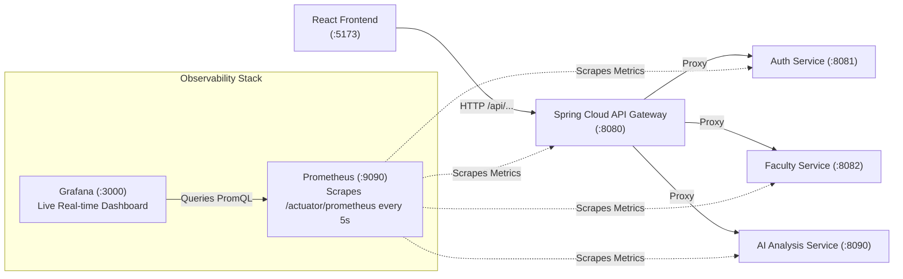

# 🎓 IntegrityAI — Faculty Evaluation Guide: API Gateway & Monitoring

> **Project**: IntegrityAI — Microservices-Based Academic Integrity & Plagiarism Detection Platform  
> **Evaluation Domains**: Microservices Architecture (MSA) & Cloud Computing / Observability  
> **Demo Environment**: Localhost (`http://localhost:5173` + `http://localhost:8080` + `http://localhost:3000`)

---

## 🏛️ PART 1: How to Explain & Demonstrate the API Gateway

When your faculty asks: **"Show me about the API Gateway in your project and why you used it"**, here is your structured, high-scoring response and live demonstration.

### 1. Conceptual Explanation (What to Say)
> *"In a monolithic architecture, a client talks directly to one web server. But in our Microservices Architecture, we have **7 independent backend services** (Auth on 8081, Faculty on 8082, Submission on 8083, Notification on 8084, Report on 8085, and Python AI Engine on 8090).*
>
> *If the frontend had to call each port directly:
> 1. The client would be tightly coupled to internal network ports and IP addresses.
> 2. Every single microservice would have to duplicate security, JWT token validation, and CORS headers.
> 3. Security would be weak because internal service ports would be exposed.
>
> *To solve this, we implemented the **API Gateway Pattern** using **Spring Cloud Gateway** running on port **`8080`**. It acts as the single unified entry point for all client requests, providing **Reverse Proxy Routing**, **Centralized JWT Authentication**, and **Unified Actuator Metrics**."*

---

### 2. Code Walkthrough (Files to Show the Professor)

Open the following 2 files in your IDE to show the concrete implementation:

#### File A: Routing Table (`application.properties`)
📂 Path: [`MSA-ML/api-gateway/src/main/resources/application.properties`](file:///c:/Users/AARMEE/Desktop/MSA%20---%20Project/IntegrityAI/MSA-ML/api-gateway/src/main/resources/application.properties)

Show your professor lines 33–70:
```properties
# 1. Route /api/auth/** & /api/users/** to Auth Service (Port 8081)
spring.cloud.gateway.server.webmvc.routes[0].id=auth-service-auth
spring.cloud.gateway.server.webmvc.routes[0].uri=${AUTH_SERVICE_URI:http://localhost:8081}
spring.cloud.gateway.server.webmvc.routes[0].predicates[0]=Path=/api/auth/**

# 2. Route /api/faculty/** to Faculty Service (Port 8082)
spring.cloud.gateway.server.webmvc.routes[2].id=faculty-service-faculty
spring.cloud.gateway.server.webmvc.routes[2].uri=${FACULTY_SERVICE_URI:http://localhost:8082}
spring.cloud.gateway.server.webmvc.routes[2].predicates[0]=Path=/api/faculty/**

# 3. Route /api/analysis/** to Python AI Engine (Port 8090)
spring.cloud.gateway.server.webmvc.routes[7].id=ai-analysis-service
spring.cloud.gateway.server.webmvc.routes[7].uri=${AI_ANALYSIS_SERVICE_URI:http://localhost:8090}
spring.cloud.gateway.server.webmvc.routes[7].predicates[0]=Path=/api/analysis/**
```
**Point out**: *"Notice that client requests do not know where the services live. The Gateway inspects the URL predicate (e.g., `/api/analysis/**`) and dynamically proxies it to the respective backend container or port."*

---

#### File B: Centralized JWT Authentication Filter (`GatewaySecurityConfig.java`)
📂 Path: [`MSA-ML/api-gateway/src/main/java/com/integrityai/gateway/security/GatewaySecurityConfig.java`](file:///c:/Users/AARMEE/Desktop/MSA%20---%20Project/IntegrityAI/MSA-ML/api-gateway/src/main/java/com/integrityai/gateway/security/GatewaySecurityConfig.java)

Show your professor how Cross-Cutting Security is centralized:
- **Public endpoints** (`/api/auth/login`, `/api/auth/register`, `/actuator/**`) are permitted without tokens.
- **All other endpoints** must pass through `JwtAuthFilter`:
  ```java
  .addFilterBefore(jwtAuthFilter, UsernamePasswordAuthenticationFilter.class)
  ```
**Point out**: *"If a student tries to upload a submission without a valid JWT token, the API Gateway intercepts and rejects the request immediately with `401 Unauthorized` before the request ever reaches the internal database or submission service."*

---

### 3. Live Hands-on Demonstrations to Show Faculty

#### Demonstration 1: Browser Network Tab (Single Entry Point Proof)
1. Open Chrome and navigate to the frontend: `http://localhost:5173`.
2. Press `F12` $\to$ click the **Network** tab.
3. Log in or click any button.
4. **Point to the request URLs**:
   ```
   Request URL: http://localhost:8080/api/auth/login
   Request URL: http://localhost:8080/api/faculty/assignments
   Request URL: http://localhost:8080/api/analysis/submit
   ```
   *Show the professor that despite 7 backend microservices, the browser ONLY connects to port `8080`.*

#### Demonstration 2: Gateway Actuator Health Check
Open a new browser tab and visit:
👉 **`http://localhost:8080/actuator/health`**
- It displays: `{"status": "UP"}`
- Shows Spring Boot Actuator health probe verifying the gateway process is running.

#### Demonstration 3: Centralized Security Interception (Curl / Browser)
In PowerShell or Postman, run:
```powershell
curl -i http://localhost:8080/api/faculty/my-assignments
```
- **Result**: `HTTP/1.1 401 Unauthorized`
- *Explanation: The Gateway blocks the request right at the perimeter because no Bearer token was supplied.*

---

## 📊 PART 2: Prometheus & Grafana Observability Stack

We have configured an enterprise-grade monitoring stack for IntegrityAI using **Prometheus** (metrics scraper & time-series database) and **Grafana** (real-time visualization dashboard).



### 1. How It Works
1. **Micrometer Actuator in Spring Boot**:
   Every Spring Boot service includes `micrometer-registry-prometheus` and exposes:
   - `http://localhost:8080/actuator/prometheus`
   - `http://localhost:8081/actuator/prometheus`
   - Emits standardized OpenMetrics (JVM memory, GC pauses, HTTP request duration, status codes, active threads).
2. **FastAPI Custom Metric Collector**:
   Python AI Engine exposes `http://localhost:8090/metrics` tracking AI inference counts, status codes, and process uptime.
3. **Prometheus Engine (`http://localhost:9090`)**:
   Pulls metrics every 5 seconds across all services via [`monitoring/prometheus/prometheus.yml`](file:///c:/Users/AARMEE/Desktop/MSA%20---%20Project/IntegrityAI/monitoring/prometheus/prometheus.yml).
4. **Grafana Dashboard (`http://localhost:3000`)**:
   Automatically provisions the pre-built **IntegrityAI Microservices Observability Dashboard** showing throughput, error rates, and resource utilization.

---

### 2. How to Launch Monitoring for Your Demo

We created a one-click startup script for monitoring:

1. Make sure **Docker Desktop** is running.
2. In the project root, double-click:
   👉 **`start-monitoring.bat`**  
   *(Or run: `docker compose -f docker-compose.monitoring.yml up -d`)*
3. That's it! Both Prometheus and Grafana will start instantly in Docker containers.

---

### 3. URLs to Show During Faculty Demo

| Service | Local URL | What to Show Faculty |
| :--- | :--- | :--- |
| **Grafana Dashboard** | **`http://localhost:3000`** | **IntegrityAI Overview Dashboard**: Live RPS graphs, JVM Heap usage, Average latency, Status code breakdown (200 OK vs 4xx/5xx). |
| **Prometheus Targets** | **`http://localhost:9090/targets`** | Show that all microservices (`api-gateway`, `auth-service`, `ai-analysis-service`) are **UP** with green badges 🟢. |
| **Prometheus Raw Metrics** | **`http://localhost:8080/actuator/prometheus`** | Show the raw time-series metrics exported by Spring Boot. |
| **Python Metrics** | **`http://localhost:8090/metrics`** | Show the Prometheus metrics exported by the FastAPI AI service. |

> [!TIP]
> **Pro Demonstration Tip**: While showing Grafana on one half of your screen, open the IntegrityAI Frontend (`http://localhost:5173`) on the other half. Perform a login and submit a document. Watch the Grafana graphs spike in real-time as requests pass through the API Gateway! Professors love seeing live metric spikes during user actions.

---

## 📋 PART 3: Quick Localhost Demo Checklist

Before your faculty arrives, follow this sequence:

1. **Start Database & Infrastructure**:
   Ensure Docker Desktop is open and run:
   ```cmd
   start-monitoring.bat
   ```
2. **Start All Microservices & Frontend**:
   Double click:
   ```cmd
   start-all-services.bat
   ```
   *(This launches each Spring Boot microservice, the FastAPI AI service, the API Gateway, and Vite Frontend in separate labeled terminal windows).*
3. **Open Your Demo Tabs in Chrome**:
   - Tab 1: Frontend Application 👉 `http://localhost:5173`
   - Tab 2: Grafana Dashboard 👉 `http://localhost:3000`
   - Tab 3: Prometheus Targets 👉 `http://localhost:9090/targets`
   - Tab 4: Gateway Health 👉 `http://localhost:8080/actuator/health`
